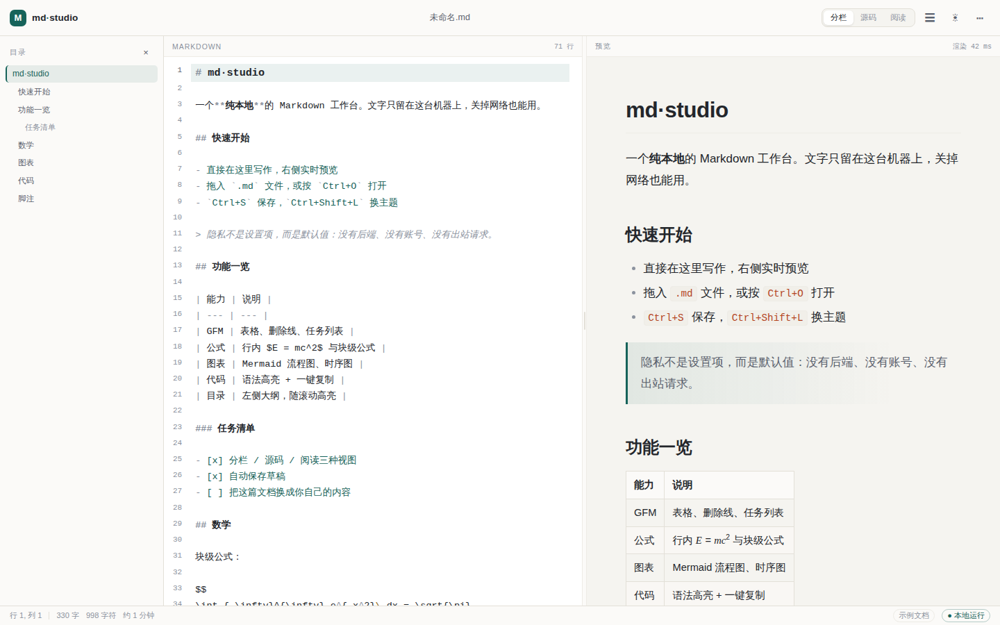
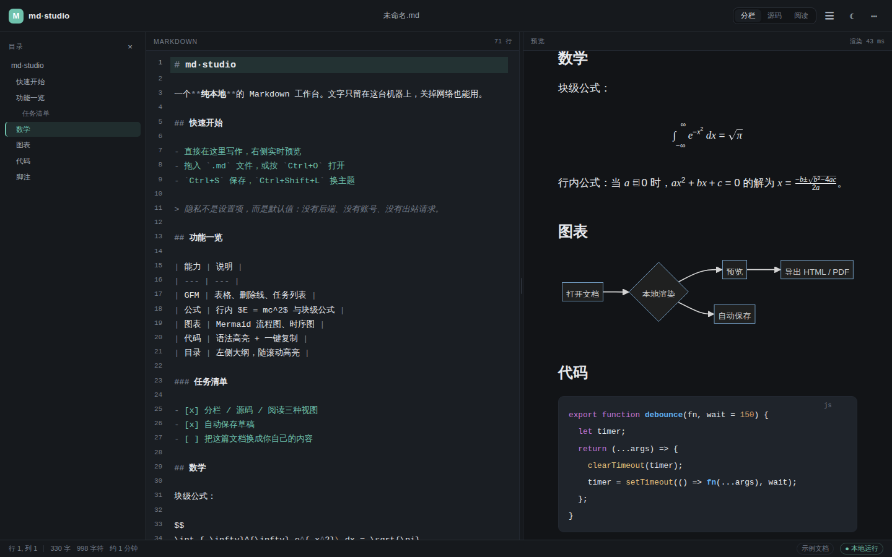
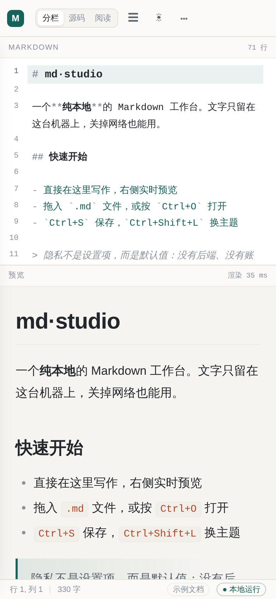

<div align="center">
  
  <h1>md·studio</h1>
  <p><strong>本地优先的 Markdown 工作台</strong><br />单文件交付 · 双击即用 · 零上传</p>
  <p>
    <a href="https://github.com/xiaoqinxing/md-studio/actions/workflows/ci.yml"></a>
    <a href="https://markdown.li.qinxing.xyz/"></a>
    
    
  </p>
</div>



写作不应该以「登录」开始。

md·studio 是一个完全运行在浏览器里的 Markdown 工作台：编辑器、实时预览、公式、图表、目录、打印和导出，全部塞进**一个 HTML 文件**。打开即写，断网可用，文档始终留在你自己的机器上。

- **零上传** —— 没有后端、没有账号、没有遥测，DevTools 里看不到任何出站请求
- **零部署** —— 构建产物是一个 2.8 MB 的 `index.html`，拷到 U 盘也能用
- **不将就** —— CodeMirror 6 编辑体验、KaTeX、Mermaid、GFM、自包含导出、A4 打印

## 功能

| 能力 | 说明 |
| --- | --- |
| **三种视图** | 分栏实时预览 / 全宽源码 / 纯阅读，`Ctrl+Enter` 循环切换，中缝可拖拽 |
| **Markdown** | GFM 表格、任务列表（点击回写源码）、删除线、脚注、自动链接 |
| **公式与图表** | KaTeX 行内 / 块级公式；Mermaid 流程图、时序图等，切换主题自动重绘 |
| **代码** | 按语言高亮、语言标签、一键复制，未知语言自动降级 |
| **阅读体验** | 目录大纲随滚动高亮、字数统计、阅读时长、字号 / 行宽 / 衬线字体可调 |
| **本地文件** | 拖拽打开；Chromium 原地读写；导出 `.md` 与自包含 `.html` |
| **文件夹工作区** | 打开整个文件夹，递归列出全部 Markdown；树形目录可展开，点击切换文件并原地保存 |
| **自动保存** | 正文、光标位置、视图设置写入 localStorage，刷新恢复；关闭前提醒 |
| **打印 / PDF** | 强制浅色、标题分页、图表与代码块不跨页，公式字体离线可用 |
| **安全** | 原始 HTML 默认关闭；所有渲染经 DOMPurify 净化；外链 `noopener` |

## 界面

深色模式下，公式、图表、代码高亮与目录会一起换色：

[](docs/preview-dark.png)

<p align="center">
  
  <br />
  <sub>窄屏自动切换为上下分栏，目录变为抽屉</sub>
</p>

## 快速开始

### 在线体验

**https://markdown.li.qinxing.xyz/**

纯前端页面，打开就能用，同样不会上传任何内容。

GitHub Pages 镜像：https://xiaoqinxing.github.io/md-studio/

### 使用单文件

下载仓库里的 [`index.html`](https://github.com/xiaoqinxing/md-studio/blob/main/index.html)，双击打开即可。

需要「原地打开 / 原地保存」本地文件时，用任意静态服务器打开：

```bash
python3 -m http.server 8765
# 浏览器访问 http://127.0.0.1:8765/index.html
```

### 从源码构建

```bash
git clone https://github.com/xiaoqinxing/md-studio.git
cd md-studio
npm ci
npm run build      # 生成单文件 index.html
npm run dev        # 监听 src/，改动自动重建
```

## 快捷键

| 快捷键 | 动作 | 快捷键 | 动作 |
| --- | --- | --- | --- |
| `Ctrl/Cmd+S` | 保存 | `Ctrl/Cmd+O` | 打开文件 |
| `Ctrl/Cmd+F` | 源码内查找 | `Ctrl/Cmd+Enter` | 切换视图 |
| `Ctrl/Cmd+B` | 粗体 | `Ctrl/Cmd+I` | 斜体 |
| `Ctrl/Cmd+K` | 链接 | `Ctrl/Cmd+E` | 行内代码 |
| `Ctrl/Cmd+Shift+O` | 打开文件夹 | `Ctrl/Cmd+Shift+L` | 切换主题 |
| `Ctrl/Cmd+\` | 收起 / 展开侧栏 | | |

## 实现

```text
Markdown 文本
   │  CodeMirror 6（编辑 / 高亮 / 搜索 / 快捷键）
   ▼
markdown-it ── GFM · 脚注 · 任务列表 · 标题锚点
   │  KaTeX · Mermaid · highlight.js
   ▼
DOMPurify ── 安全 HTML ── 预览 / 导出 / 打印
```

| 层 | 选型 |
| --- | --- |
| 编辑器 | [CodeMirror 6](https://codemirror.net/)（自定义 Markdown 高亮主题） |
| 渲染 | [markdown-it](https://github.com/markdown-it/markdown-it) + footnote / anchor 插件 |
| 数学 | [KaTeX](https://katex.org/)，woff2 字体内联进 HTML |
| 图表 | [Mermaid 10](https://mermaid.js.org/)，按主题缓存 SVG |
| 净化 | [DOMPurify](https://github.com/cure53/DOMPurify) |
| 构建 | [esbuild](https://esbuild.github.io/) → 单个 `index.html` |

`npm run build` 会做四件事：打包应用与依赖、把 KaTeX 字体转成 base64、把 Mermaid 压缩后内嵌（浏览器端解压）、注入 HTML 模板。运行时**没有任何 CDN 请求**。

## 隐私与安全

- 全站零网络请求；CI 会断言除页面自身与 `data:` / `blob:` 外没有出站流量
- 原始 HTML 默认关闭；开启后仍会经过 DOMPurify，事件属性与脚本会被剥离
- 外链统一加 `target="_blank" rel="noopener noreferrer"`
- 本地文件通过 File System Access API 直接读写，不经过任何服务器
- 草稿与设置存在浏览器 localStorage，按站点隔离

## 开发与测试

```bash
npm run build     # 构建单文件产物
npm run dev       # 监听构建
npm run ci        # 构建产物 + Chrome 冒烟测试（自带静态服务器）
npm test          # 渲染 / 交互 / XSS / 导出 / 移动端回归（需先起 8765 服务）
npm run stress    # 大文档压测，SECTIONS=2900 可测 1 MB（需 8765 服务）
```

脚本会自动使用本机缓存的 Playwright Chromium；也可以通过 `CHROME=/path/to/chrome` 指定浏览器。

| 脚本 | 覆盖内容 |
| --- | --- |
| `scripts/ci.mjs` | 产物完整性、首屏、TOC、公式、图表、主题、实时编辑、零外链 |
| `scripts/qa.mjs` | 持久化、导出 HTML、打印 PDF、文件打开、任务回写 |
| `scripts/func.mjs` | 无 FSA 降级保存、XSS 净化、快捷键、目录、移动端 |
| `scripts/stress.mjs` | 大文档加载、编辑器输入延迟、预览渲染耗时 |
| `scripts/deploy-qdeploy.mjs` | 通过 qdeploy 发布 `markdown.li.qinxing.xyz` |

## 持续集成与发布

- 每次 push / PR：`npm ci` → 构建 → Chrome 冒烟测试
- push 到 `main`：
  - 自动发布到 **GitHub Pages**（镜像）
  - 自动发布到 **https://markdown.li.qinxing.xyz/**（qdeploy）
- 工作流：[`.github/workflows/ci.yml`](.github/workflows/ci.yml)

自定义域名部署依赖仓库 Secret：

1. 打开 **Settings → Secrets and variables → Actions → New repository secret**
2. Name 填 `QDEPLOY_TOKEN`
3. Value 填 qdeploy 的 Bearer token
4. 未配置时该步骤会输出 warning 并跳过，不会让整个工作流失败

qdeploy 的 MCP 接口请求体上限约 4 MB，脚本会在超过 4.1 MB 时直接失败，避免悄悄部署失败。

若仓库首次启用 Pages 失败，在 **Settings → Pages → Source** 选择 **GitHub Actions** 后重跑工作流即可。

## 性能

本机（Chromium，1440×900）实测：

| 场景 | 结果 |
| --- | --- |
| 145 KB / 420 节文档 | 打开约 0.7 s，编辑输入延迟约 28 ms |
| 1 MB / 2900 节文档 | 输入延迟约 40 ms，预览渲染约 0.85 s，刷新自动延后 |

超过 120 KB 的文档会主动延后预览刷新，优先保证输入跟手；超大文档建议直接保存为文件，而不是依赖 localStorage 草稿。

## 已知边界

- 暂不支持 Typora 式所见即所得，Markdown 源码始终是唯一真源
- 图片支持 URL / base64，暂未做粘贴自动内嵌
- 自动保存受 localStorage 约 5 MB 配额限制
- Mermaid 以 gzip + base64 内嵌，运行时用 `DecompressionStream` 解压（Chrome 80+ / Safari 16.4+ / Firefox 113+）；不支持时降级显示图表源码
- 原地读写依赖 File System Access API，Firefox / Safari 降级为导入 + 下载
- 文件夹工作区只在当前页面会话中有效，刷新后需重新选择；单个文件夹最多扫描 1500 个 Markdown 文件，自动跳过隐藏目录和 `node_modules` / `dist` 等目录
- 在 Electron（部分桌面内置浏览器）中，系统目录选择器首次使用后可能无法再次打开，第二次切换文件夹会自动降级为兼容导入（只读，保存走另存为 / 下载）

## Roadmap

- [x] 单文件离线交付、CI、GitHub Pages 自动发布
- [x] 文件夹工作区：树形浏览、点击切换、原地保存
- [ ] Milkdown 所见即所得模式
- [ ] 截图粘贴自动内嵌
- [ ] 文件夹全文搜索
- [ ] 导出 Word / EPUB

## 致谢

感谢 [CodeMirror](https://codemirror.net/)、[markdown-it](https://github.com/markdown-it/markdown-it)、[KaTeX](https://katex.org/)、[Mermaid](https://mermaid.js.org/)、[highlight.js](https://highlightjs.org/) 与 [DOMPurify](https://github.com/cure53/DOMPurify) —— 没有这些开源项目，就没有这个单文件。

---

<p align="center"><sub>为写作而生，不为注册而生。</sub></p>

